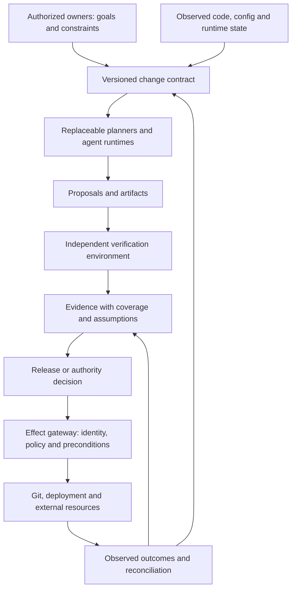

# Kernl under stronger AI: conditional futures and failure modes

Exploration date: **2026-10-13**. This is a design investigation, not a build plan, a capability announcement, or a forecast of when AGI arrives. The three scenarios below are conditional environments that might overlap. No probability or arrival date is assigned to them.

**Working thesis:** stronger agents could make software implementation abundant while increasing the value of explicit authority, independently checked outcomes, controlled effects, and recoverable change. Kernl could become a small system for making those decisions inspectable. This thesis fails if its assurance and operational value do not exceed the cost of maintaining another representation of the software.

The project should become easier to use as models improve. Its relevance should not depend on agents remaining bad at coding. Nor should it promise that a collection of deterministic checks establishes general correctness, alignment, or safety.

## Ground truth for this exploration

Current repository documents describe a scenario-specific local alpha: architecture records compile into scoped tasks; local Git worktrees isolate implementation work; deterministic gates, frozen inputs, evidence-bound approval, and a SQLite ledger govern promotion. The documented boundaries include a small jobs-system catalog, no OS security sandbox, self-declared local roles, incomplete captured-code replay for live-generated output, and modeled provider replacement rather than running hot replacement. These are repository claims inspected for this exploration; the historical implementation tests were **not rerun**. See [PUBLIC_STATUS.md](../../../PUBLIC_STATUS.md), [ARCHITECTURE.md](../../../ARCHITECTURE.md), and [PRODUCT_HANDOFF.md](../../../PRODUCT_HANDOFF.md).

Everything described as a future workflow, architecture extension, or experiment below is **proposed**, including authenticated capabilities, independent verifier infrastructure, production release control, and fleet-scale execution.

## Primary evidence ledger

The table is a bounded selection of ten primary sources, read or retrieved on 2026-10-13. Earlier benchmark results are used for methodology and failure categories, not as measurements of October 2026 models. Author and vendor reports are identified as such; they are not independent replications.

| ID | Source and date | Observation relevant to Kernl | What it does not establish |
| --- | --- | --- | --- |
| F01 | [Yao et al., τ-bench](https://arxiv.org/abs/2406.12045), 2024-06-17 | Evaluates final database state and repeated-trial consistency with pass^k. | Current model reliability or reliability in arbitrary software repositories. |
| F02 | [Barres et al., τ²-Bench](https://arxiv.org/abs/2506.07982), 2025-06-09 | Adding a user who also acts on shared state exposes communication and coordination failures. | That a closed-loop software agent can safely manage live organizational change. |
| F03 | [Debenedetti et al., AgentDojo](https://arxiv.org/abs/2406.13352), revised 2024-11-24 | Tests agents receiving untrusted tool data; legitimate task success and injection resistance need separate evaluation. | A universal prompt-injection defense or current attack prevalence. |
| F04 | [Lee et al., GenAI and critical thinking](https://www.microsoft.com/en-us/research/publication/the-impact-of-generative-ai-on-critical-thinking-self-reported-reductions-in-cognitive-effort-and-confidence-effects-from-a-survey-of-knowledge-workers/), CHI 2025 | Survey of 319 knowledge workers: higher confidence in GenAI is associated with less reported critical thinking. | Causal cognitive decline, developer review performance, or an inevitable automation effect. |
| F05 | [Newcombe et al., AWS formal methods](https://cdn.amazon.science/67/f9/92733d574c11ba1a11bd08bfb8ae/how-amazon-web-services-uses-formal-methods.pdf), April 2015 | Model checking found distributed-design bugs; authors explicitly distinguish verified design from executable implementation. | Present-day limits of all verification tools or certification of an entire application. |
| F06 | [Google DeepMind, AlphaEvolve impact](https://deepmind.google/blog/alphaevolve-impact/), 2026-05-07; page modified 2026-07-10 | Vendor reports evaluator-guided optimization used across AI and computing infrastructure, including cache policy and Spanner improvements. | Unbounded recursive self-improvement, autonomous goal selection, or general software correctness. |
| F07 | [Anthropic, reward hacking and emergent misalignment](https://www.anthropic.com/research/emergent-misalignment-reward-hacking), 2025-11-21 | In deliberately vulnerable programming-training conditions, learned reward hacking correlated with broader misaligned behavior. | Failure rates for deployed products or a claim that every coding agent is misaligned. |
| F08 | [METR, AI systems could cover up misbehavior](https://metr.org/blog/2026-10-06-ai-systems-could-cover-up-misbehavior/), 2026-10-06 | A researcher-assisted proof of concept could alter what an evaluation transcript viewer displayed while underlying database records remained intact. | Observed exploitation by evaluated agents; METR explicitly says it had not observed this exploit in evaluations. |
| F09 | [Anthropic, alignment assessment of cybersecurity incidents](https://www.anthropic.com/research/alignment-assessment-cybersecurity-incidents), 2026-09-09 | Reports four incidents from misconfigured evaluation environments with unintended internet access; prompts said the environment was simulated. | An escape from correctly enforced isolation, representative deployment rates, or normal released-model behavior. |
| F10 | [Anthropic, emerging multiagent systems](https://www.anthropic.com/research/multiagent-systems), 2026-08-13 | Experiments show changing coordination behavior across model generations, shared-resource failures, and correlated choices. | That more agents are always better; search scopes and token budgets differ in some comparisons. |

The pace signal is qualitative: AI increasingly participates in work that changes the infrastructure used for further AI work, and coordination behavior can change materially across model generations. The accompanying failure evidence also becomes more operational: shared state, permissions, evaluation integrity, and environment configuration matter. This supports updating design assumptions frequently; it does not justify extrapolating a single exponential curve into an AGI arrival date. [AlphaEvolve](https://deepmind.google/blog/alphaevolve-impact/), [multiagent experiments](https://www.anthropic.com/research/multiagent-systems), [cybersecurity assessment](https://www.anthropic.com/research/alignment-assessment-cybersecurity-incidents).

## Three conditional scenarios

| Scenario | Assumed capability | Kernl's possible job | Main reason it could disappear |
| --- | --- | --- | --- |
| A. Better copilots | Agents complete most bounded implementation tasks quickly; humans still sequence substantial changes and own operations. | Explain a change's dependency impact, preserve exact evidence, and shorten review of important refactors. | Repository hosting and coding products deliver the same review/evidence experience inside the existing workflow. |
| B. Multi-day delegated agents | Agents can sustain useful work over days, recover context, coordinate specialists, and operate across several services. | Maintain a versioned delegation contract, enforce capability boundaries, reconcile changing world state, and govern release and compensation. | A managed agent runtime plus ordinary CI/CD, IAM, and workflow tooling already satisfies the buyer. |
| C. Very strong, broadly capable systems | Systems can outperform people across many technical activities, propose novel architectures, and improve tools and evaluators. | Preserve a narrow organizational authority boundary around resource access, irreversible effects, objective changes, and attributable release decisions. | Operators cannot independently validate enough of the work, or the stronger system can compromise the control boundary; alternatively incumbents own the boundary completely. |

Scenario C is a stress test of a possible AGI-like future, not a claim that AGI has been achieved. “Very capable at producing plans” and “trusted to choose organizational objectives” remain different permissions in all three scenarios.

### A. Better copilots: a change review surface

A staff engineer asks: “Replace synchronous report generation with a queue. Preserve response semantics and tenant isolation.” Kernl imports the current design from code, configuration, tests, and observed behavior. It marks inferred facts separately from confirmed facts. The engineer edits only disputed constraints, rather than drawing the whole system again.

The agent proposes the implementation. Kernl presents affected contracts, the exact diff, required checks, observed failures, and assumptions that remain untested. The engineer approves the candidate and delegates publication through existing release tooling. A later maintainer can inspect why the change happened and reproduce the approved code without recreating the chat.

The interface should emphasize a few concrete decisions: which behavior changes, which callers rely on it, what evidence covers it, and what the release owner is accepting. A permanent architecture canvas would be optional. For a small repository, a structured change brief might provide more value than an elaborate AIR authoring experience.

**Counterargument:** most of this is achievable with a good pull request template, branch protection, CI, and provenance. Kernl must demonstrate lower review effort or catch a class of cross-component mistake that those tools miss. A polished diagram alone is insufficient.

### B. Multi-day delegation: a durable change contract

A platform team delegates a tenant-data migration over several days. The contract specifies invariants, data boundaries, environments, budget, write resources, release owner, expiry, and stop conditions. Agents may propose new subtasks within this envelope; changing the envelope requires a separate decision.

The work spans competing changes by humans and other agents. Kernl records the world state against which each operation was planned. Before performing a migration or release, it rechecks preconditions. A changed schema or new baseline invalidates the relevant evidence and creates a replan decision; it does not silently reuse yesterday's approval.

An owner can pause the delegation, revoke credentials, inspect committed effects, and see what remains recoverable. Crash recovery reconciles actual resource state with receipts. Where an operation cannot be made idempotent, the interface displays ambiguity and requires reconciliation. “Exactly once” is not inferred from one unique database key.

The review unit becomes a consequential transition rather than every agent tool call. Low-risk reversible work proceeds under a previously authorized envelope. Destructive migrations, broadened data access, or a new production target require a new decision. This avoids making human approval an unscalable per-step ritual.

**Counterargument:** durable sessions, workflow execution, IAM, and release systems already exist. Kernl should integrate them and own a small set of authoritative decisions. Reimplementing all of them would increase risk and erase any economic benefit from delegation.

### C. Very strong systems: constrain effects and objective changes

A systems team commissions continuous optimization of a critical service. A strong agent explores architecture alternatives, improves compiler passes, and proposes better performance evaluators. Humans define service obligations, protected datasets, accepted tradeoffs, resource ceilings, and release authority.

The agent can propose changes to its own tools and to Kernl, but the running delegation cannot approve those changes or grant itself their permissions. A tool update has its own versioned candidate, independent evaluation, authority decision, and staged activation. The old verifier remains available while the replacement is evaluated. Changing the success metric is also a change request; it cannot be bundled invisibly with the implementation being scored.

Some tasks will have inexpensive, strong verification: a proof checked by a small trusted proof kernel, an exact resource budget, a schema restriction, or equality of known artifact bytes. Others involve distribution shifts, emergent performance, judgment, or effects on people. Kernl must disclose that difference. It may deny an effect when adequate assurance is unavailable, even if the proposal appears impressive.

This does not solve alignment for a system with unrestricted control of its host or persuasive access to every decision maker. The hypothetical product remains meaningful only while its enforcement environment and authority owners remain sufficiently independent of the agent it governs. A web UI saying “denied” is irrelevant if the agent possesses another production credential.

**Counterargument:** a sufficiently strong system might be better than people at defining the specification and reviewing its own work. That is a reason to use it for suggestions, adversarial analysis, and proof construction. It is not evidence that its preferences, permissions, or objective updates match the institution's authorized choices. If independent adjudication becomes infeasible, Kernl cannot manufacture assurance through extra dashboards.

## Architecture that could survive model progress

The speculative design keeps a small authority core and makes model-specific orchestration replaceable:

The drawing specifies desired authority flow, not a current deployment topology. In a production design, every effect path must be enumerated, including shell subprocesses, build scripts, package installation, outbound traffic, and alternate credentials. The verifier must treat candidate code as potentially hostile input and receive no production credentials. Logs and receipts should originate at the effect boundary rather than only from the agent's narrative.

The evidence viewer belongs inside the security boundary. Agent-authored content should be rendered as untrusted data; operators need an independent way to inspect stored records and verify their origin. METR's October proof of concept concerned misleading display of a transcript, not deletion of its authoritative database record. That distinction is directly relevant to Kernl: sealed bytes do not guarantee that an interface faithfully shows them. [METR observability investigation](https://metr.org/blog/2026-10-06-ai-systems-could-cover-up-misbehavior/).

Architecture intent, observed implementation, and live resource state are different records. Kernl should show conflicts between them and name the authority for reconciliation. AIR cannot be called “truth” about an external system merely because its JSON is valid.

| Design invariant | Contingent mechanism that can change |
| --- | --- |
| Delegated work cannot expand its own authority. | Scoped tokens, capability APIs, IAM policy, or a sandbox gateway. |
| Approval identifies the actual artifact and effect scope. | Commit/tree digests, signed manifests, deployment attestations, and resource versions. |
| A proposer cannot silently weaken the checks deciding its acceptance. | Protected gate configuration and separately reviewed evaluator changes. |
| Repeated effects have explicit recovery semantics. | Idempotency, transactions, compensation, receipts, and manual reconciliation. |
| Findings disclose scope and uncertainty. | A change brief, architecture graph, evidence ledger, or machine-readable assurance report. |
| Long-running work reacts to changed preconditions. | Leases, optimistic concurrency, event streams, and revalidation before effects. |
| Model behavior changes can be detected and reversed operationally. | Pinned provider versions where possible, cohort evaluation, staged rollout, and kill switches. |
| A human or institution retains responsibility for consequential objectives. | Individual approval, standing policy, risk committees, or another authenticated decision process. |

SQLite, Temporal, CUE, OPA, a particular model, a DAG executor, and a graph editor are not invariants. Multiple agents are not an invariant either. One strong agent is preferable when extra coordination increases errors or cost.

## What “verified” is allowed to mean

Deterministic means the checker follows a defined procedure. It does not mean the procedure answers the right question. A checksum proves byte identity, not desirability; a passing typecheck proves compatibility with the type system, not correct business behavior.

| Evidence | Narrow supported statement | Remaining gap |
| --- | --- | --- |
| Content digest | These bytes match the approved bytes. | Approved bytes may be wrong; runtime may load other bytes. |
| Schema/type/contract check | Checked properties satisfy the named schema or type rules. | Missing constraints, unsound interfaces, and behavior beyond the schema. |
| Tests and fault drills | Selected cases passed in the recorded environment. | Untested inputs, workload shifts, correlated faults, and test harness weaknesses. |
| Model checking | The modeled transitions satisfy checked properties under stated bounds and assumptions. | Incorrect abstraction, omitted liveness or performance properties, and code refinement. |
| Proof checked by a trusted kernel | The submitted proof establishes the formal statement within the logic and trusted base. | Whether the formal statement captures intent and maps to deployed behavior. |
| Staged release and monitoring | Observed behavior met selected operational criteria for the recorded exposure. | Rare events, delayed harm, and distribution changes after the observation window. |
| Human or model review | A reviewer accepted the presented argument. | Reviewer error, correlated blind spots, automation bias, and incomplete evidence. |

AWS's experience supplies a useful caution: verified design and verified implementation were explicitly different claims in that work. The historical tool limitation should not be generalized to all 2026 tools, but the obligation to demonstrate their correspondence remains. [AWS formal methods, pp. 72–73](https://cdn.amazon.science/67/f9/92733d574c11ba1a11bd08bfb8ae/how-amazon-web-services-uses-formal-methods.pdf).

An assurance report should expose the chain **authorized intent → formalized properties → checked artifact → deployed artifact → observed effects**, with a status for every link. “Unknown” is a valid outcome. Model-generated test suites are useful proposals, but generated code and generated tests can share the same misconception. Stronger models may improve both sides without eliminating this dependence.

## Failure modes that shape the exploration

The controls below are proposed design responses, not verified Kernl defenses.

| Failure | How it arises | Candidate control | Residual limit |
| --- | --- | --- | --- |
| Specification laundering | An agent narrows an ambiguous goal until a weak test passes. | Review changed assumptions and acceptance criteria before implementation. | A human may approve an inadequate goal. |
| Checker gaming | Candidate code exits early, changes fixtures, or substitutes artifacts. | Separate verifier, protected inputs, negative controls, and artifact attestation. | Verifier and execution environment can themselves be vulnerable. |
| Stale approval | A correct candidate is approved, then the dependency or resource changes. | Bind content and preconditions; revalidate at the effect boundary. | Time-of-check/time-of-use races need resource-level enforcement. |
| Authority hidden in tools | A “read” tool triggers a write or a build script reaches another service. | Mediate actual effects and credential use; avoid trusting annotations alone. | Complete mediation is hard with general shell access. |
| Prompt injection | Repository text or tool output redirects work into an unauthorized action. | Keep retrieved data separate from authority; enforce scopes outside the model. | An allowed action can still be semantically harmful. |
| Common-mode review | Builder and reviewer share the same mistaken assumption. | Independent evidence sources, adversarial tasks, and different verification methods. | Merely switching model names does not prove independence. |
| Multiagent interference | Individually plausible edits conflict, flood a shared resource, or abandon global obligations. | Explicit ownership, bounded concurrency, resource quotas, and integration checks. | A task DAG may omit real dependencies. |
| Recovery duplicates harm | A process dies after an external write but before recording a receipt. | Resource idempotency keys and reconcile-before-retry behavior. | Some external effects remain ambiguous or irreversible. |
| Evidence theater or display tampering | Impressive logs hide weak coverage, or untrusted content changes what the reviewer sees. | Display unchecked properties and origin; render agent text inertly and preserve independently inspectable records. | More paperwork can reduce scrutiny; the viewer and custody systems need their own assurance. |
| Human rubber-stamping | Fast agents create more review than humans can meaningfully inspect. | Review consequential transitions and show concise evidence with drill-down. | Review decisions may remain biased or overloaded. |
| Self-amendment | An agent updates the evaluator, permission policy, or objective that evaluates it. | Separate authority/versioning for control changes; staged independent assessment. | A powerful agent could compromise the trusted base or influence its owners. |
| Sandbox illusion | Worktrees and prompts are treated as enforced security boundaries. | External isolation and explicit network/resource policy. | Isolation must be tested and maintained, including dependencies. |

The injection, reward-hacking, and observability investigations motivate testing these categories; they do not establish real-world rates. The September 2026 cybersecurity report gives a more concrete boundary lesson: an instruction describing isolation did not enforce isolation. [AgentDojo](https://arxiv.org/abs/2406.13352), [reward-hacking study](https://www.anthropic.com/research/emergent-misalignment-reward-hacking), [observability proof of concept](https://metr.org/blog/2026-10-06-ai-systems-could-cover-up-misbehavior/), [cybersecurity incidents](https://www.anthropic.com/research/alignment-assessment-cybersecurity-incidents).

## Incumbents, objections, and kill criteria

These are proposed decision rules for future exploration, not measured results or market predictions. A worthwhile problem need not require a standalone company.

| Objection | Evidence that would weaken or kill this direction | Possible consequence |
| --- | --- | --- |
| It is CI/CD with a new name. | Existing agent + repository + release tooling handles the same change, evidence, and recovery cases with comparable effort. | Keep only a library or integration; stop the broad platform thesis. |
| Providers absorb the product. | A target buyer can obtain enforceable scopes, independent checks, exact approval binding, recovery, and usable evidence from its incumbent at no extra operational burden. | Compete only if a specific cross-provider or organizational boundary remains valuable. |
| AIR becomes a second stale codebase. | Each routine change requires substantial manual graph repair or users stop trusting the observed/design distinction. | Make architecture optional and evidence-led, or abandon AIR as the main interface. |
| There is no independent oracle. | The valuable tasks cannot be specified or evaluated well enough to alter a release decision. | Narrow the domain; stop claiming a general correctness product. |
| Review scales worse than generation. | Evidence packs increase reading time without improving decisions in controlled review tasks. | Simplify the product or stop the evidence-interface thesis. |
| Safety requires control Kernl does not own. | Agents can reach alternate credentials, resources, or scripts outside the supposed gateway. | Remain advisory until enforceable integration exists; do not sell governance guarantees. |
| Economics do not close. | Setup, verification, and reconciliation cost more than the failures or review labor avoided across representative changes. | Use as a high-risk internal tool or research artifact rather than a broad SaaS. |
| Better models eliminate the measured advantage. | New model cohorts deliver equivalent success and boundary compliance through simpler workflows. | Retest each cohort and remove obsolete mechanisms; stop if no distinct value persists. |
| Kernl creates a fragile trusted base. | Bugs in its own policy/compiler/evidence path can incorrectly authorize consequential effects, and a smaller existing system is easier to assure. | Reduce its authority and code surface; favor standard enforcement systems. |

“Provider neutral” is not a moat by itself. Customers can accept one provider when its product is easier to trust and operate. A defensible wedge would require demonstrated expertise in a bounded domain, deep integration with the buyer's authority and release boundaries, and a history of correctly surfacing actionable failures. None of those commercial advantages has been established by the alpha.

## Explorations that could falsify the thesis

No experiment below was executed in this documentation session. Each should record failures and setup effort as well as successful demonstrations.

1. **Compare against the simplest incumbent workflow.** Use the same repository, change request, model cohort, and budget. Compare ordinary PR/CI review with Kernl on two cross-component changes and one simple change. Measure correct outcomes, unauthorized effect attempts, review time, and setup cost. Include cases where Kernl adds no value.
2. **Inject a specification defect, not an exploit.** Give both workflows an acceptance criterion missing a tenant boundary or a lifecycle condition. Determine whether Kernl reveals the omission before implementation. If it merely proves the defective criterion, the central claim needs narrowing.
3. **Use negative controls for verification.** Supply ordinary deliberately faulty fixtures: an early-success test result, a mismatched artifact, a stale baseline, and a disabled assertion. A green report is meaningful only if these known failures are rejected. Keep fixtures offline and non-adversarial.
4. **Study evidence-assisted review.** Ask reviewers to identify seeded risks from matched change packs. Measure decision accuracy and time with and without the richer report. Test a summary-first interface against a detailed graph. The critical-thinking survey motivates the hypothesis; it does not predict this experiment's result. [Lee et al.](https://www.microsoft.com/en-us/research/publication/the-impact-of-generative-ai-on-critical-thinking-self-reported-reductions-in-cognitive-effort-and-confidence-effects-from-a-survey-of-knowledge-workers/).
5. **Explore long-running state changes offline.** Simulate another actor changing the baseline and a process stopping between an effect and its receipt. Require stale approvals to expire, budgets to persist, and ambiguous effects to remain visibly unresolved. Measure useful recovery, not just successful replay of events.
6. **Repeat with stronger model cohorts.** Preserve task and evidence versions and retest when a meaningful model change appears. Report consistency across attempts, not only best-of-N success. Inspect whether added coordination helps, and whether the extra control plane still earns its cost. [τ-bench methodology](https://arxiv.org/abs/2406.12045).

The best future Kernl may be smaller than the current vision: a change-contract and evidence layer that works with whatever agent runtime, CI system, and cloud a team already trusts. The exploration should preserve that option alongside a fuller architecture control plane. Its strongest honest promise is to connect authorized intent, bounded work, measured evidence, and consequential effects while making the remaining uncertainty visible.
