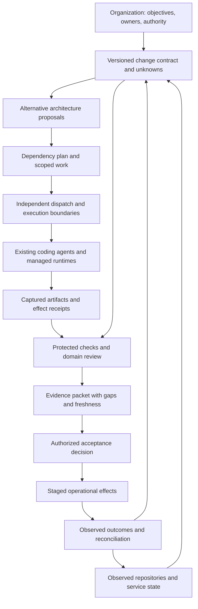

# What Kernl could look like

Concept study: **2026-10-13**. Every workflow and component below is proposed unless identified as a present prototype mechanism in [Current state](CURRENT-STATE-AND-POSITIONING.md).

## The human problem

Imagine a platform team receiving many useful changes from capable agents. Producing patches is easy enough that the limiting questions become: What behavior did we agree to change? Which systems are affected? Who may act? What evidence is independent? What changed while the work ran? Can we accept the result, and did it work after release?

Kernl could make those questions one inspectable change record. Its first useful customer might be a platform or architecture team making multi-component changes with explicit reliability or data-handling constraints. This is a customer hypothesis. It needs comparison with a pull request plus CI plus native agent controls before choosing a product category.

## A possible primary experience

The opening screen is a list of proposed, active, blocked, and accepted **changes**, not a count of agents. A user opens a change and sees:

1. **Intent and unknowns:** desired outcome, owner, assumptions, baseline, affected systems, and unanswered questions.
2. **Before and after:** a graph and ordinary code diff, with every inferred connection labeled as inferred. The user can reject the architecture proposal before implementation.
3. **Authority:** exact repositories, operations, data boundaries, time and cost envelope, protected checks, and who can expand the scope.
4. **Evidence:** requirement-to-check links, captured candidate artifacts, failed attempts, independent results, freshness, and limitations.
5. **Acceptance:** what is established, what remains uncertain, who may decide, and precisely what their approval covers.
6. **Operation:** staged rollout, actual effect receipts, health criteria, remaining old consumers, and rollback or compensation limits.

This must save the user from reconstructing context across a chat, issue, code review, CI logs, cloud console, and incident system. If users still need to reconstruct everything in those tools, a prettier graph has not solved the problem.

## Three concrete journeys

### 1. Architect-led behavior change

Example: move a synchronous export into an asynchronous worker while preserving request semantics and avoiding duplicate external notifications.

The architect supplies the outcome and constraints. A model may propose several designs, including keeping the synchronous path. Kernl would distinguish assumptions from inspected facts, show the affected contracts, and ask for missing evidence. After a design is selected, existing coding agents work in their native environments under scoped permissions. A separate acceptance path validates both the code and the behavior that matters.

Acceptance binds an artifact and its check context. If the baseline, dependencies, required checks, or authority change, the record becomes stale. Deployment is a separate effect with separate evidence. The current alpha covers part of the source-code journey; it does not establish a production rollout or exactly-once external notification.

### 2. A long delegated migration

Example: migrate a shared client library across several services, with overlapping agent work and releases over multiple days.

The proposed record captures consumer dependencies, incompatible versions, ownership, and progress against an initial snapshot. Agents can propose smaller changes as new information appears. A conflict or new consumer should invalidate the affected plan segment rather than silently alter the objective. Progress survives a provider interruption without conferring new authority on a replacement worker.

An operator could ask why a service remains blocked and see the dependency and evidence gap. A retiring version stays active until observed reliance is gone and cleanup is confirmed. Provider-native checkpoints may support resumption; Kernl would still need an independent reconciliation of repository and operational state. This is a major extension of the current local lifecycle model.

### 3. Continuous improvement with very strong AI

Example: an AI proposes a faster data-processing implementation every week, sometimes changing architecture rather than optimizing a function.

The organization owns the objective, cost and reliability constraints, and protected acceptance criteria. A proposal identifies its measurements and tradeoffs. Changes to the evaluator, authority, or objective become separate reviewed changes; improving a score cannot authorize modifying what the score means. Evaluation runs and operational observations feed later proposals without becoming automatic permanent permissions.

This could be useful whether intelligence improves incrementally or becomes broadly capable. It is not a claim that human-written policies can reliably contain an arbitrarily strong adversary. Evidence systems and enforcement boundaries themselves require independent review.

## A possible architecture

All boxes describe a possible target architecture. Dated prior runs reported demonstrations of a narrower local path. The graph does not imply implementation, independently secured boundaries, or general verification.

## Proposed core records

| Record | Contents to investigate | Why it matters |
|---|---|---|
| Change contract | Intended behavior, non-goals, owners, assumptions, baseline digests, open questions | Prevent silent reinterpretation of the task |
| Architecture record | Components, contracts, bindings, dependencies, uncertainty, observation provenance | Connect intent to actual implementation; avoid a stale hand-maintained world model |
| Authority grant | Subject, actions, resource bounds, expiry, budgets, delegation rules, revocation state | Separate ability to act from permission to act |
| Work commitment | Inputs, dependencies, tool/runtime identity, write scope, retry and repair envelope | Make delegated work accountable and resumable |
| Evidence claim | What is claimed, artifact, checker, result, limitation, independent custodian, freshness | Trace a conclusion to the evidence that supports it |
| Acceptance decision | Exact artifact and evidence context, accountable decision-maker, conditions, expiry | Reduce approval drift and ambiguous promotion |
| Effect record | Intended effect, receipt, current observation, reconciliation, compensating action limits | Avoid treating a successful command as proof of a successful business change |

These are conceptual fields, not a schema migration. Do not expand AIR to contain every fact about an organization. Start with the minimum needed to explain one change and its dependencies.

## Build, integrate, or leave with the supplier?

| Concern | Research default | Evidence that could change it |
|---|---|---|
| Model inference, agent loop, compaction, subagents | Use native runtimes through bounded adapters | Required semantics cannot be expressed without owning a small part of the loop |
| Workflow durability and scheduling | Evaluate existing workflow systems and runtime services | A measured gap requires narrowly scoped Kernl coordination |
| Identity, secrets, OS/container isolation | Integrate established infrastructure | Deployment constraints require a reviewed alternative; local Git worktrees are insufficient |
| Code review, CI, observability, artifacts | Reuse existing systems and link their evidence | Native records lose the exact context required for an acceptance decision |
| Change intent, evidence bindings, acceptance semantics | Leading candidate for Kernl ownership | Users find the record redundant or it cannot remain accurate at reasonable cost |
| Operational rollout and recovery | Treat as a later integration boundary | Source-level value is demonstrated and operators identify a concrete missing control |

Managed platforms already provide many pieces; [Industry pace](INDUSTRY-PACE.md) and [Runtime signals](CAPABILITY-AND-RUNTIME-SIGNALS.md) describe that evidence. These defaults are design choices, not claims that any vendor lacks the proposed semantics.

## What changes as AI gets stronger?

- Replace hand-authored templates with model-proposed designs only after uncertainty and acceptance criteria can be surfaced clearly.
- Let models help produce and challenge checks, but protect the adopted evaluator from the implementation worker and treat evaluator revisions separately.
- Move from source-path scoping toward effects and resource authority when work crosses services. A file allowlist does not constrain an already-authorized external tool.
- Prefer short-lived, revocable delegation over fixed trust in an agent name or model family.
- Shift review from every line toward inspectable commitments where evidence warrants it; retain detailed artifacts for contested or high-impact decisions.
- Treat competing providers as replaceable execution choices where their actual semantics permit it. A common interface cannot erase differences in state, tools, networking, and recovery.

These are conditional adaptations. Better AI could also compress the useful product into an evidence export format, a review integration, or a few protected tools.

## Product choices still open

The narrowest option is an evidence packet and reviewer view attached to ordinary changes. A larger option is an architecture workspace controlling code-level acceptance. The broadest is a system for continuously delegated organizational change. Explore them in that order of burden, and compare each with the simpler alternative.

Potential value lies in reduced review/rework, clearer accountability, and fewer accepted changes with unrecognized evidence gaps. Potential costs are maintaining intent, configuring checks, integrating tools, reviewer overload, and a second source of truth. No demand, pricing, or moat is validated here.
